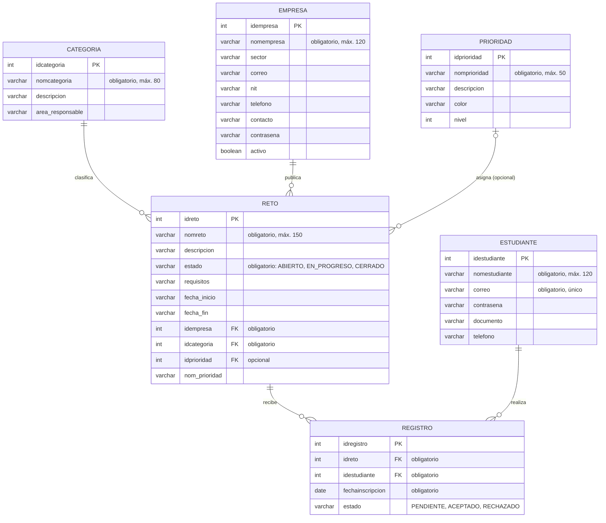

# Banco de Retos de Innovación CESDE — Backend

API REST del **Banco de Retos de Innovación Abierta** del CESDE. Permite que las empresas publiquen retos de innovación, que los estudiantes se postulen a ellos y que las empresas revisen las postulaciones recibidas.

Este README corresponde únicamente a la parte backend del proyecto integrador. El frontend (React + Vite) se documenta por separado.

---

## 1. Descripción del proyecto

La aplicación centraliza la relación entre dos actores:

- **Empresas**: publican retos de innovación (por ejemplo, un modelo de detección de fraude o una ruta de entrega optimizada), con requisitos, fechas y prioridad, y revisan las postulaciones que reciben.
- **Estudiantes / participantes**: consultan el catálogo de retos abiertos, filtran por área temática y se postulan.

**Dirigida a:** equipos de desarrollo del curso (para entender y extender la API), docentes que supervisan el proyecto y el frontend que consume los servicios.

---

## 2. Tecnologías utilizadas

| Componente | Tecnología / Versión |
| :--- | :--- |
| Lenguaje | Java 21 |
| Framework | Spring Boot 4.1.0 (Spring Web MVC, Spring Data JPA) |
| Persistencia | Hibernate / JPA |
| Base de datos principal | MySQL (XAMPP / MySQL Workbench) |
| Base de datos de apoyo | H2 (solo para consola de pruebas) |
| Herramienta de construcción | Maven (con Maven Wrapper `mvnw`) |
| Serialización JSON | Jackson |
| Desarrollo | Spring Boot DevTools |

Dependencias principales declaradas en `pom.xml`: `spring-boot-starter-data-jpa`, `spring-boot-starter-webmvc`, `spring-boot-h2console`, `spring-boot-devtools`, `h2`, `mysql-connector-j`.

---

## 3. Arquitectura

El backend sigue una arquitectura en capas, con los paquetes en español:

```text
com.Cesde.bancoretos
├── Controlador/   → Recibe las solicitudes HTTP y devuelve respuestas JSON
├── Servicio/      → Reglas de negocio y validaciones
├── Repositorio/   → Acceso a datos (interfaces Spring Data JPA)
├── Modelo/        → Entidades JPA (tablas de la base de datos)
├── Dto/           → Objetos de transferencia de datos
└── Config/        → Configuración (datos iniciales)
```

### Capas

- **Entity (`Modelo/`)**: clases anotadas con `@Entity`. Representan las tablas y sus relaciones:
  - `MEmpresa`, `MEstudiante`, `MCategoria`, `MPrioridad`: entidades base.
  - `MReto`: pertenece a una empresa, una categoría y (opcionalmente) una prioridad. Relación `@ManyToOne`.
  - `MRegistro`: postulación de un estudiante a un reto. Relación `@ManyToOne` con `MReto` y `MEstudiante`.
  - Las relaciones inversas (`@OneToMany`) están en `MEmpresa`, `MCategoria`, `MPrioridad`, `MEstudiante` y `MReto`. Se marcan con `@JsonIgnore` para evitar ciclos al serializar.
- **Repository (`Repositorio/`)**: interfaces que extienden `JpaRepository`. Incluyen consultas personalizadas con `@Query`, por ejemplo la búsqueda por texto en retos y la consulta de postulaciones por empresa.
- **Service (`Servicio/`)**: contiene las reglas de negocio. Algunas de las validaciones principales son:
  - No se pueden repetir nombres de categoría ni prioridad, ni correos de estudiante.
  - No se puede eliminar una categoría, empresa, estudiante o prioridad que tenga retos o postulaciones asociadas.
  - No se puede postular a un reto que esté `CERRADO` o que no exista.
  - Un estudiante no puede postularse dos veces al mismo reto.
  - Un estudiante que fue `RECHAZADO` no puede volver a inscribirse en ese reto.
- **Controller (`Controlador/`)**: expone los endpoints REST bajo el prefijo `/api`. Cada método captura las excepciones del servicio y devuelve un JSON con la clave `error` y el código HTTP correspondiente.

### Mapper y DTO

- **DTO**: el paquete `Dto/` contiene `EmpresaRetoDTO`, que se usa en `GET /api/empresas/{id}/retos`. Expone solo el nombre de la empresa, su sector y correo, y el nombre y estado del reto. Así no se devuelven todos los campos de la entidad.
- **Mapper**: el proyecto no usa una capa de mapeo independiente (por ejemplo MapStruct). La conversión entre entidades y JSON se resuelve con las anotaciones `@JsonProperty` y los campos transitorios (`@Transient`) de `MReto` y `MRegistro`, que reciben los IDs de empresa, categoría, prioridad, reto o estudiante desde el cuerpo de la petición.

### Datos iniciales

La clase `Config/DataInitializer` carga datos de prueba la primera vez que arranca la aplicación, solo si las tablas están vacías:

- 4 prioridades (ALTA, MEDIA, BAJA, URGENTE).
- 7 categorías (Logística, Tecnología, Educación, Economía, Ecología, Nutrición, Psicología).
- 4 empresas de ejemplo.
- 8 retos de ejemplo (2 por empresa).

---

### 3.1 Modelo de datos (diagrama relacional)

La base de datos MySQL `bancoretos` tiene cinco entidades principales y una tabla de relación (`registro`). Los nombres de columna siguen la convención de Spring Boot: los atributos en camelCase se convierten a snake_case (por ejemplo, `fechaInicio` se guarda como `fecha_inicio`).



#### Cardinalidad

| Relación | Cardinalidad | Descripción |
| :--- | :--- | :--- |
| Categoría → Reto | 1 a N | Una categoría agrupa muchos retos. Cada reto tiene exactamente una categoría. |
| Empresa → Reto | 1 a N | Una empresa publica muchos retos. Cada reto tiene exactamente una empresa. |
| Prioridad → Reto | 1 a N (opcional) | Una prioridad puede asignarse a muchos retos. El reto puede no tener prioridad. |
| Reto → Registro | 1 a N | Un reto recibe muchas postulaciones. |
| Estudiante → Registro | 1 a N | Un estudiante realiza muchas postulaciones. |

## 4. Requisitos previos

- **JDK 21** o superior (verificar con `java -version`).
- **Maven** no es obligatorio, porque el proyecto incluye el Maven Wrapper (`mvnw` / `mvnw.cmd`). Si se prefiere instalar Maven, la versión 3.9 o superior es suficiente.
- **MySQL 8** o **XAMPP** con el servicio MySQL activo en el puerto `3306`.
- **MySQL Workbench** (opcional) para inspeccionar la base de datos.
- **Git** para clonar el repositorio.

### Base de datos

La configuración por defecto espera:

- Servidor: `localhost:3306`
- Usuario: `root`
- Contraseña: vacía

La base de datos `bancoretos` se crea automáticamente gracias al parámetro `createDatabaseIfNotExist=true` de la URL de conexión. Las tablas se crean o actualizan automáticamente porque `spring.jpa.hibernate.ddl-auto=update`.

---

## 5. Instalación y configuración

### 5.1 Clonar el repositorio

```bash
git clone <URL-del-repositorio>
cd "Proyecto integrador/Proyecto Integrador Back"
```

### 5.2 Configurar variables de entorno (opcional)

Actualmente la configuración está en `src/main/resources/application.properties` y no usa variables de entorno. Si se desea separar las credenciales del código, se puede reemplazar el valor por una variable:

```properties
spring.datasource.username=${DB_USER:root}
spring.datasource.password=${DB_PASSWORD:}
```

En Windows (PowerShell) la variable se define con `$env:DB_PASSWORD="mi_clave"`.

### 5.3 Verificar la base de datos

1. Iniciar MySQL desde XAMPP.
2. Confirmar que el usuario `root` tiene acceso con la contraseña configurada.

No es necesario crear la base de datos manualmente.

### 5.4 Iniciar la aplicación

```powershell
.\mvnw.cmd spring-boot:run
```

Al iniciar, la consola debe mostrar que Tomcat escucha en el puerto `8080` y que la aplicación `bancoretos` arrancó correctamente.

---

## 6. Configuración interna

Archivo: `src/main/resources/application.properties`

| Propiedad | Valor actual | Descripción |
| :--- | :--- | :--- |
| `server.port` | `8080` | Puerto de la API |
| `spring.application.name` | `bancoretos` | Nombre de la aplicación |
| `spring.datasource.url` | `jdbc:mysql://localhost:3306/bancoretos?...` | Conexión a MySQL |
| `spring.datasource.username` | `root` | Usuario de la base de datos |
| `spring.datasource.password` | (vacía) | Contraseña de la base de datos |
| `spring.jpa.hibernate.ddl-auto` | `update` | Crea y actualiza tablas automáticamente |
| `spring.jpa.show-sql` | `false` | No muestra las consultas SQL en consola |
| `spring.h2.console.enabled` | `true` | Habilita la consola H2 |
| `spring.h2.console.path` | `/h2-console` | Ruta de la consola H2 |

### URLs de referencia

- API base: `http://localhost:8080/api`
- Consola H2: `http://localhost:8080/h2-console`


### Usuarios de demostración

Los usuarios de demostración se crean en la tabla de empresas y estudiantes al registrarse. Las credenciales de prueba que se usan en el frontend son:

| Rol | Correo | Contraseña |
| :--- | :--- | :--- |
| Empresa | `empresa@cesde.edu.co` | `123456` |
| Estudiante | `estudiante@cesde.edu.co` | `123456` |


---

## 7. Endpoints de la API

Todas las rutas empiezan con `/api`. Los endpoints que reciben cuerpo usan JSON.

### 7.1 Autenticación — `CAuth` (`/api/auth`)

| Método | Ruta | Descripción |
| :--- | :--- | :--- |
| GET | `/api/auth/ping` | Verifica que la API esté en línea |
| POST | `/api/auth/login` | Inicia sesión con `correo`, `contrasena` y `rol` (`ESTUDIANTE` o `EMPRESA`) |
| POST | `/api/auth/registro` | Registra un nuevo usuario con `nombre`, `correo`, `contrasena`, `rol`, `documento` y `telefono` |

Ejemplo de login:

```json
{
  "correo": "estudiante@cesde.edu.co",
  "contrasena": "123456",
  "rol": "ESTUDIANTE"
}
```

### 7.2 Empresas — `CEmpresa` (`/api/empresas`)

| Método | Ruta | Descripción |
| :--- | :--- | :--- |
| GET | `/api/empresas` | Lista empresas. Acepta `?filtro=` para buscar por nombre, sector o NIT |
| GET | `/api/empresas/{id}` | Consulta una empresa por su ID |
| POST | `/api/empresas` | Crea una empresa |
| PUT | `/api/empresas/{id}` | Actualiza una empresa |
| DELETE | `/api/empresas/{id}` | Elimina una empresa (solo si no tiene retos) |
| GET | `/api/empresas/{id}/retos` | Lista los retos de la empresa en formato `EmpresaRetoDTO` |

### 7.3 Estudiantes — `CEstudiante` (`/api/estudiantes`)

| Método | Ruta | Descripción |
| :--- | :--- | :--- |
| GET | `/api/estudiantes` | Lista estudiantes. Acepta `?filtro=` por nombre o correo |
| GET | `/api/estudiantes/{id}` | Consulta un estudiante por su ID |
| POST | `/api/estudiantes` | Crea un estudiante |
| PUT | `/api/estudiantes/{id}` | Actualiza un estudiante |
| DELETE | `/api/estudiantes/{id}` | Elimina un estudiante (solo si no tiene postulaciones) |

### 7.4 Categorías — `CCategoria` (`/api/categorias`)

| Método | Ruta | Descripción |
| :--- | :--- | :--- |
| GET | `/api/categorias` | Lista categorías. Acepta `?filtro=` por nombre o área responsable |
| GET | `/api/categorias/{id}` | Consulta una categoría por su ID |
| POST | `/api/categorias` | Crea una categoría (el nombre no puede repetirse) |
| PUT | `/api/categorias/{id}` | Actualiza una categoría |
| DELETE | `/api/categorias/{id}` | Elimina una categoría (solo si no tiene retos) |

### 7.5 Prioridades — `CPrioridad` (`/api/prioridades`)

| Método | Ruta | Descripción |
| :--- | :--- | :--- |
| GET | `/api/prioridades` | Lista todas las prioridades |
| GET | `/api/prioridades/{id}` | Consulta una prioridad por su ID |
| POST | `/api/prioridades` | Crea una prioridad |
| PUT | `/api/prioridades/{id}` | Actualiza una prioridad |
| DELETE | `/api/prioridades/{id}` | Elimina una prioridad (solo si no tiene retos) |

### 7.6 Retos — `CReto` (`/api/retos`)

| Método | Ruta | Descripción |
| :--- | :--- | :--- |
| GET | `/api/retos` | Lista retos. Acepta los filtros `filtro`, `estado`, `idcategoria` e `idempresa` |
| GET | `/api/retos/abiertos` | Lista solo los retos con estado `ABIERTO` |
| GET | `/api/retos/{id}` | Consulta un reto por su ID |
| GET | `/api/retos/empresa/{idempresa}` | Lista los retos de una empresa |
| GET | `/api/retos/categoria/{idcategoria}` | Lista los retos de una categoría |
| POST | `/api/retos` | Crea un reto |
| PUT | `/api/retos/{id}` | Actualiza un reto |
| DELETE | `/api/retos/{id}` | Elimina un reto |

Ejemplo de creación de reto (los IDs se envían como campos simples):

```json
{
  "nomreto": "Plataforma Web de Tutoría Adaptativa",
  "descripcion": "Herramienta que identifica vacíos de conceptos en programación.",
  "estado": "ABIERTO",
  "requisitos": "React, consumo de APIs.",
  "fechaInicio": "2026-10-05",
  "fechaFin": "2026-11-20",
  "idempresa": 2,
  "idcategoria": 3,
  "idprioridad": 2
}
```

### 7.7 Postulaciones (registros) — `CRegistro` (`/api/registros`)

| Método | Ruta | Descripción |
| :--- | :--- | :--- |
| GET | `/api/registros` | Lista todas las postulaciones |
| GET | `/api/registros/{id}` | Consulta una postulación por su ID |
| GET | `/api/registros/estudiante/{idestudiante}` | Postulaciones de un estudiante |
| GET | `/api/registros/empresa/{idempresa}` | Postulaciones recibidas por una empresa |
| GET | `/api/registros/reto/{idreto}` | Postulaciones a un reto |
| POST | `/api/registros` | Postula un estudiante a un reto |
| PUT | `/api/registros/{id}` | Cambia el estado de la postulación |
| DELETE | `/api/registros/{id}` | Elimina una postulación |

Estados válidos de una postulación: `PENDIENTE`, `ACEPTADO`, `RECHAZADO`.
Estados válidos de un reto: `ABIERTO`, `EN_PROGRESO`, `CERRADO`.

### 7.8 Formato de respuestas

- **Éxito**: el recurso en JSON, o un mensaje (`{"mensaje": "..."}`) en operaciones de eliminación.
- **Creación**: código `201 Created`.
- **Error de validación o regla de negocio**: código `400 Bad Request` con `{"error": "descripción"}`.
- **Recurso no encontrado**: código `404 Not Found` con `{"error": "..."}`.
- **Error interno**: código `500 Internal Server Error` con `{"error": "..."}`.

---

## 8. Pruebas unitarias

### Cómo crear una prueba

1. Crear la clase en `src/test/java/com/Cesde/bancoretos/` con el mismo paquete de la clase que se va a probar.
2. Anotarla con `@SpringBootTest` (prueba de contexto completo) o con `@WebMvcTest` (solo capa web).
3. Usar `@MockitoBean` para simular los repositorios o servicios que no se quieren ejecutar.

Ejemplo mínimo de prueba para el endpoint de ping:

```java
@WebMvcTest(CAuth.class)
class CAuthTest {

    @Autowired
    private MockMvc mockMvc;

    @MockitoBean
    private IEmpresa iEmpresa;

    @MockitoBean
    private IEstudiante iEstudiante;

    @Test
    void pingDebeResponderOnline() throws Exception {
        mockMvc.perform(get("/api/auth/ping"))
               .andExpect(status().isOk())
               .andExpect(jsonPath("$.status").value("ONLINE"));
    }
}
```

## 9. Licencia y derechos de autor

Proyecto académico desarrollado para el **Proyecto Integrador** del CESDE (Banco de Retos de Innovación Abierta).

Pendiente: definir la licencia del repositorio (por ejemplo MIT o uso académico restringido) y agregar el archivo `LICENSE` a la raíz del proyecto.

Derechos de autor © 2026, Equipo del Proyecto Integrador CESDE. Todos los derechos reservados salvo que se indique lo contrario.
